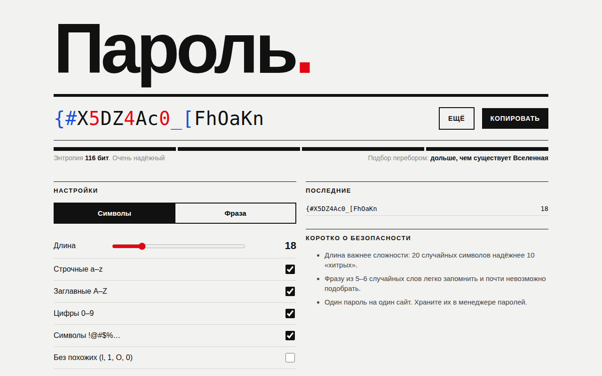

# Пароль.

Генератор паролей и парольных фраз в швейцарском стиле: строгая сетка, крупная типографика, один акцентный цвет. Пароли создаются в браузере и никуда не отправляются.



## Возможности

**Режим «Символы»**
- Длина от 6 до 64 символов
- Наборы: строчные, заглавные, цифры, спецсимволы; если снять все, включаются строчные
- Гарантированно хотя бы один символ из каждого выбранного набора
- Опция «Без похожих» убирает i, l, 1, I, o, O, 0 и `|`

**Режим «Фраза»**
- От 3 до 10 слов из словаря на транслите, чтобы фразу принимали любые сайты
- Свой разделитель до двух символов, слова с заглавной буквы, число в конце

**Общее**
- Оценка энтропии в битах и шкала из четырёх уровней надёжности
- Примерное время перебора при 100 млрд попыток в секунду
- Цифры и спецсимволы в пароле выделены цветом
- История последних 8 паролей за сессию, копирование по клику
- Копирование в один клик, пробел генерирует новый пароль

## Стек

HTML5, CSS3 (Grid), JavaScript без библиотек, Web Crypto API (`crypto.getRandomValues`), Clipboard API.

## Как запустить

Сборка не нужна: откройте `index.html` в браузере.

Или через локальный сервер:

```bash
python -m http.server 8000
# затем откройте http://localhost:8000
```

## Настройка

В начале `<script>` в `index.html`:

- `SETS`: наборы символов
- `SIMILAR`: регулярное выражение для похожих символов
- `WORDS`: словарь для парольных фраз
- Скорость перебора задана в `crackTime()`

## Структура проекта

```
index.html      # разметка, стили и генератор в одном файле
screenshot.png  # скриншот для README
LICENSE         # лицензия MIT
```

## Как это устроено

- Случайные числа берутся из `crypto.getRandomValues`, а не из `Math.random`. Значения из «хвоста» диапазона отбрасываются, поэтому нет смещения по модулю.
- Сначала берётся по одному символу из каждого набора, остальное добирается из общего пула, затем массив перемешивается алгоритмом Фишера-Йетса.
- Энтропия считается как `длина × log2(размер пула)` для символов и `слов × log2(размер словаря)` плюс `log2(90)` за число для фраз.
- Время перебора берётся как половина пространства вариантов, делённая на скорость атаки, и выводится в секундах, минутах, часах, днях или годах.
- История живёт только в памяти вкладки и не сохраняется в localStorage.
- Если Clipboard API недоступен, копирование идёт через временное текстовое поле и `execCommand('copy')`.

## Идеи для развития

- Проверка пароля по базе утечек через k-анонимный запрос к Have I Been Pwned
- Русский словарь для фраз с отдельной опцией
- Офлайн-режим через Service Worker

## Лицензия

MIT © 2026 whysafe. Telegram: [@yawhysafe](https://t.me/yawhysafe) · Сайт: [whysafe.ru](https://whysafe.ru)
